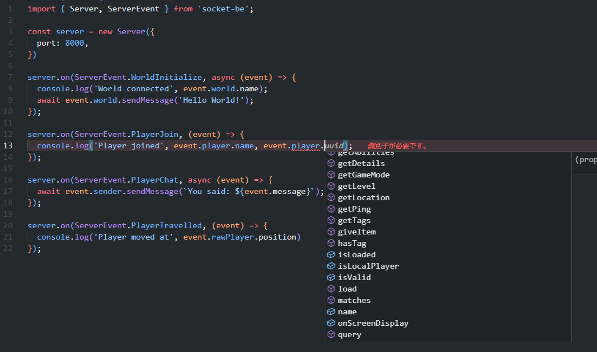

[English](./README.md) | [日本語](./README_ja.md) | **简体中文**

# SocketBE
一个强大的，与 MCBE Websocket 协议交互的 Websocket 库



## 功能
- 完全类型化的原版事件处理器
- 执行命令 + 响应处理
- 支持多个连接
- 多种包装 API（世界、玩家、记分版等）
- 支持加密

## 安装:
需要 Node.js 18 或更高版本。
```bash
npm install socket-be
```
```bash
pnpm add socket-be
```
```bash
bun add socket-be
```

## 从 Minecraft 连接：
您可以使用 `/wsserver` 或 `/connect` 命令连接到 WebSocket 服务器。

**命令用法：** `/wsserver <HOST>:<PORT>`

**例如：** `/wsserver localhost:8000`

## 示例
```js
import { Server, ServerEvent } from 'socket-be';

const server = new Server({ port: 8000 });

server.on(ServerEvent.Open, () => {
  console.log('Server started');
});

// Outputs received messages to the console and sends them back to Minecraft
server.on(ServerEvent.PlayerChat, async (ev) => {
  const { sender, message, world } = ev;

  console.log(`<${sender.name}> ${message}`);

  await world.sendMessage(`You said: ${message}`);
});
```

```js
// Log player joins and leaves
server.on(ServerEvent.PlayerJoin, (ev) => {
  console.log(`${ev.player.name} joined the game`);
});

server.on(ServerEvent.PlayerLeave, (ev) => {
  console.log(`${ev.player.name} left the game`);
});
```

```js
// Execute a command
server.on(ServerEvent.PlayerChat, async (ev) => {
  const { message, world } = ev;

  if (message === '!diamond') {
    await world.runCommand('give @a diamond');
  }
});
```

亦可查询 DeepWiki：https://deepwiki.com/tutinoko2048/SocketBE

## License
本项目按 MIT 许可证授权。
